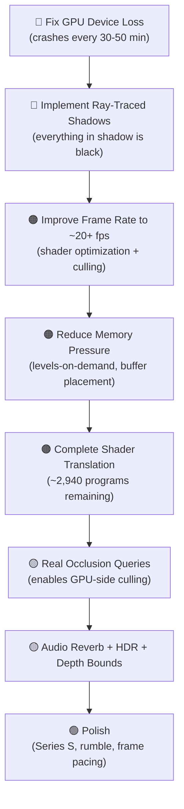

# VIctory Fork — Playability Resume

> [!NOTE]
> Based on a full review of the fork at [/workspaces/victory-fork](file:///workspaces/victory-fork) (147K lines of Rust across 160 source files, 9 crates). Last commit: `e4245f3` (2026-11-26).

## Current State: Playable, But Barely

The game boots, runs menus at 30 fps, plays the opening cutscene fully lit, autosaves work, and the tester has played through the prologue and past the first boat mission. **However, it runs at ~8–9.5 fps in the world (console target: 30 fps), crashes after 30–50 minutes, and shadows are completely black.** Tested on one machine only (i7-14700KF, RTX 4070 12 GB, 32 GB RAM).

---

## What Still Needs to Be Done

### 🔴 Critical — Game-Breaking Issues

#### 1. GPU Device Loss (Crashes Every Session)
The graphics card is "lost" (Windows error `0x887A0005` — device removed) after **30–50 minutes of play**, consistently before the next save point. This makes the game unfinishable.

- **Root cause unknown.** Investigated extensively: not video memory exhaustion (84–92% budget, never over), no page fault address reported, no single trigger identified.
- Constant buffer views exceeding 64 KiB are now capped (a potential cause on NVIDIA), but not confirmed as the fix.
- The crash tracing (`VICTORY_D3D12_DRED=faults`) costs nothing measurable, but hasn't revealed the cause.
- Multiple sessions all crash heading toward the same story area, suggesting a draw/resource trigger, not a time trigger.

> **Needed:** Isolate and fix the device removal cause. The pipeline library replacement race is fixed, but the core issue persists.

#### 2. Shadows Are Completely Black
Everything not in direct sunlight is **solid black** — interiors, shadowed faces, rooms lit only by lamps. This is because the game's **ray-traced indirect lighting and shadows do not function yet**.

- The title uses compute-shader-based ray tracing (not DXR API), with hardware `image_bvh64_intersect_ray` instructions emulated in DXIL.
- **BVH builder:** 49 of 52 compute programs translate, but the builder stays off in real runs because a few pipelines are refused (they require 64-lane waves on a 32-lane GPU).
- **Trace programs:** 59 of 64 translate; **5 shadow-mask trace programs do not translate yet**.
- With `VICTORY_BVH_BUILDER=1` the builder is gated on all pipelines being valid — currently none run.
- The emulated ray/box and ray/triangle tests are unit-tested against a reference on the GPU (311 cases), but have **never run end-to-end in the game**.

> **Needed:** Get the remaining 3 builder programs + 5 shadow-mask trace programs translating; handle the 64-lane → 32-lane wave mismatch for water/builder programs; run the BVH builder end-to-end and debug the lighting pipeline.

---

### 🟠 Major — Severe Impact on Playability

#### 3. Frame Rate: 8–9.5 fps (Target: 30 fps)
At the first boat mission with 3,000–5,000 draws, the frame rate is **~3x below the console target**. The bottleneck has shifted from CPU to GPU:

| Bottleneck | Current State |
|------------|---------------|
| GPU card time | 84–128 ms/frame (target ~33 ms) — spread over ~1,300 pipelines |
| Translated shaders | ~2.4× the console's instruction count on average |
| CPU submit thread | ~60 ms/frame (with both worker optimizations on) |
| Streaming frames | ~490 ms when the camera moves (card idle 330 ms during remaps) |

- **Shader optimization passes** (dead code, constant folding, value reuse) already cut host instructions by ~43% and GPU time by ~20 ms/frame, but shaders are still 2.4× the console's.
- **166 `shortcut:` markers** in the codebase indicate approximations that may cost performance.
- Many speed switches exist but are **off by default** — the measured-best configuration uses `VICTORY_HEAP_WORKER=1`, `VICTORY_SETTLE_ROOM=1`, `VICTORY_PARALLEL_REFRESH=1` together.

> **Needed:** Further shader translation optimization (the translated programs' instruction bloat is now the primary wall); reduce the per-draw clamp overhead; address streaming frame stalls from title memory remapping (~850 page remaps per streaming frame at ~0.1 ms each).

#### 4. Memory Pressure
~24–27 GB of system RAM and 9.2–9.6 GB of the card's 10.3 GB budget are in use during play.

- On a 32 GB system, only 1–5 GB free — close to thrashing.
- The card is full from the first world frame: **26,000 texture copies let go and 3,400 remade in 5 minutes**, 2.8 GB of render targets always in use.
- `VICTORY_LEVELS_ON_DEMAND=1` could save 2.2–3.0 GB (only allocate mip levels the title holds), but has **never run on a real GPU** — only on the software adapter.
- Title buffers (3.6 GB of vertex/index/constant data) are in system memory and read over the PCIe bus on every draw.

> **Needed:** Enable and validate levels-on-demand on hardware; evaluate buffer placement strategies; reduce the 44,613 textures-let-go-and-remade cycle.

#### 5. Shader Translation Coverage Gaps
The translator doesn't handle all shader programs the game uses:

| Category | Translated | Total | Gap |
|----------|-----------|-------|-----|
| Mesh shaders | 8,191 | 8,506 | 315 |
| Vertex/Pixel | 10,617 | 12,346 | 1,729 |
| Compute | 1,643 | 2,539 | 896 |

Missing capabilities:
- **64-bit image atomics** (used by some compute programs)
- **Merged geometry stages** (combined vertex+geometry)
- **64-lane wave programs** running on 32-lane hardware (affects water and BVH builder)
- 5 shadow-mask ray-trace programs
- Untranslated shaders cause their **draws to be silently dropped** — parts of the scene simply don't render.

> **Needed:** Implement 64-bit image atomics, merged geometry stages, and the 64→32 lane wave conversion; translate the remaining ~2,940 shader programs.

---

### 🟡 Moderate — Noticeable but Not Blocking Core Gameplay

#### 6. GPU Queries Are Fake
From [query.rs](file:///workspaces/victory-fork/crates/victory-gpu/src/query.rs#L1-L2):
> *"Nothing runs on a GPU yet, so no query ever produces a result"*

- Occlusion queries always return "visible" (a switch `VICTORY_OCCLUSION` exists for host-side queries, off by default).
- Pipeline statistics queries return plausible fixed values.
- This means no occlusion culling — the GPU draws everything, contributing to the frame rate problem.

> **Needed:** Implement real occlusion queries on the host GPU for proper culling.

#### 7. Depth Bounds Testing Not Implemented
The README's upstream status table lists **depth bounds** as missing. The comparison codes for depth/stencil are approximated:
> *"shortcut: the comparison codes are taken to be the comparison"* ([list.rs](file:///workspaces/victory-fork/crates/victory-gpu/src/list.rs#L1870))

> **Needed:** Implement depth bounds test state on host D3D12 pipelines.

#### 8. HDR and Display Scaling Missing
Listed as missing in the upstream status table. The title presents at 3840×2160 internally regardless of `VICTORY_DISPLAY_MODE` — the display mode is reported but ignored by the title. No HDR tone mapping.

> **Needed:** Implement HDR output support and proper resolution scaling/display mode handling.

#### 9. Audio: Reverb Is Silent, DSP Not Emulated
From [dsp.rs](file:///workspaces/victory-fork/crates/victory-hle/src/modules/dsp.rs#L14):
> *"Outputs are silence, so reverb returns are dry."*

- XMA voice decoding and Opus streams work.
- DSP effects (reverb, convolution) are **stubbed to output silence**.
- Audio capture exists for debugging (`VICTORY_AUDIO_CAPTURE`).
- Speech accessibility APIs are largely stubbed with `missing::` markers.

> **Needed:** Implement DSP reverb processing (the console's audio flowgraphs are not emulated).

#### 10. Render-Target Metadata Planes Not Supported
From [texture.rs](file:///workspaces/victory-fork/crates/victory-formats/src/texture.rs#L819):
> *"shortcut: no compression metadata planes (HTILE, CMASK, FMASK, DCC)"*

The console GPU uses these for bandwidth compression. Without them, some render-target operations may produce incorrect results or fall back to uncompressed paths.

> **Needed:** Implement HTILE/CMASK/FMASK/DCC metadata plane support for correct render-target handling.

---

### 🟢 Minor / Polish — Not Blocking Playability

#### 11. Series S Mode Doesn't Render the World
Series S profile runs menus but the world is black (mean brightness 0). Only Series X is usable.

#### 12. Input: Trigger Rumble Not Implemented
XInput pads and keyboard-as-pad work. Trigger rumble (Xbox impulse triggers) is missing.

#### 13. Intermittent First-Room Rendering Bug
> *"The interior of the first gameplay room is sometimes not drawn after the cutscene hands over to gameplay."*

Appears in some launches but not others — a timing or memory-sync race.

#### 14. Frame Pacing Drift
> *"Frame pacing drifts on one screen in release builds"* (menus)

#### 15. HLE Interface Gaps
Many Xbox runtime interfaces have `missing::` stubs (not called by this title but would affect other titles):
- Speech-to-text, closed captions, high contrast accessibility
- Message dialogs, send invite, achievements, player picker, error dialogs
- Some GameInput methods (`QueryInterface`, dispatcher, aggregate device)
- Diagnostic screenshot/clip capture

#### 16. Texture Format Gaps  
XOR tiling modes (`_X`, `_T`) and MSAA layouts have no addressing support. These would need to be added if the title uses them.

---

## Summary Prioritization

## Key Metrics at a Glance

| Metric | Current | Target |
|--------|---------|--------|
| World FPS | 8–9.5 | 30 |
| Session stability | 30–50 min crash | No crashes |
| Shader coverage | ~86% mesh, ~86% VS/PS, ~65% compute | 100% |
| Shadow lighting | Black | Lit (ray-traced) |
| RAM usage | 24–27 GB | Fits in 16–32 GB comfortably |
| VRAM usage | 9.2–9.6 / 10.3 GB | ≤8 GB with headroom |
| `shortcut:` approximations | 166 | Reduce to correctness-critical only |
| Env switches (`VICTORY_*`) | ~100+ unique | Promote measured winners to defaults |
